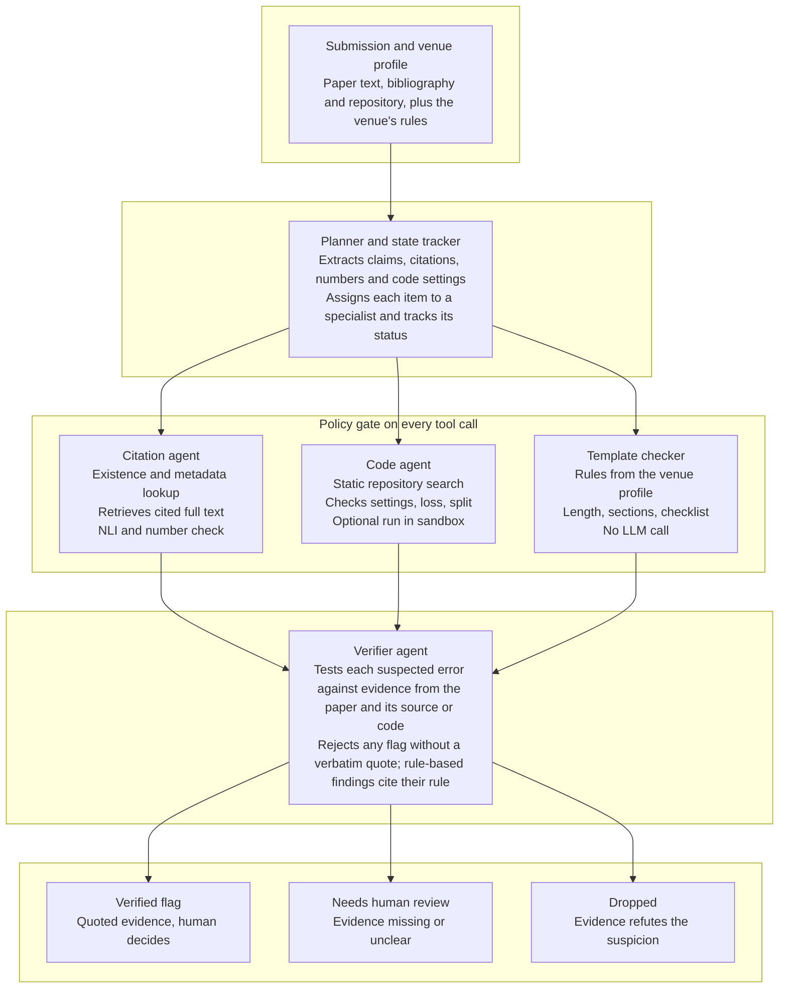

# Group Project Proposal: Evidence-Gated Verification Agent for Research Paper Auditing

Team: Hood Research Department  
Vijay Aravynthan (2023111007)  
Anurag Peddi (2023101090)  
Itikela Bhaskar (2023111032)  
Sudheera Y S (2023111002)  

## Problem statement

We want to build a system that checks research conference submissions for factual correctness (specifically focusing on citations and data) before a human reviewer reads them.

Currently, reviewers at big conferences do not have the time to check if a cited paper supports the claim being made, or if the numbers in the paper match the numbers in the code repository. With LLM-assisted writing tools, it is easier than ever to accidentally include fake or wrong references.

Existing tools mostly just check if a citation exists, but they do not read the cited paper to verify the claim. Prompted LLM reviewers also miss things because they cannot easily access the full text or code. We propose an AI agent that retrieves the cited full texts and the code, tests each suspected error against the actual text, and hands the uncertain cases over to a human reviewer.

| User | What they need | How they use the output |
| :--- | :--- | :--- |
| Conference organizers, area chairs | Fast triage of integrity problems in a large submission pool | Review a ranked list of evidence-backed flags, a human makes every decision |
| Paper authors | A pre-submission check for honest mistakes | Fix wrong citations, number slips and code-text mismatches before submitting |

## Research questions and hypotheses

RQ1. Does a verification-loop agent that retrieves cited full texts and code repositories detect more errors with fewer false alarms than the same model running in a single pass without agentic loops?

Goal: The full agent system will beat the simple single-pass baseline by at least 10 percentage points in overall Macro-F1, without increasing the number of false alarms on clean, correct papers.

## Why the problem matters

Integrity checks are important as conference submissions increase (e.g: ICLR 2026 had over 60K submissions). Reviewers rarely open cited papers or run code. Unless a tool catches a wrong claim-citation pairing or a code mismatch, the error survives.

However, a useful tool must also be safe to deploy. Falsely accusing an author is harmful. Therefore, the system must clearly show its evidence using exact quotes and must state when it does not know the answer.

## What is missing in existing approaches

| Existing approach | What it covers | Gap for our problem |
| :--- | :--- | :--- |
| Citation Checkers (e.g., HALLMARK) | Reference existence and metadata (DOI, authors) | No test of whether the cited source supports the claim |
| Prompted LLM Reviewers | Errors that are present in the text | Miss omissions because they lack access to cited full texts or code repositories |
| Paper-to-code benchmarks (e.g., SciReplicate-Bench) | Generating code from a paper's method | Does not audit whether existing code matches the text |

## Capabilities and why the problem needs each

| Capability | Why the problem needs it | Primary metrics | Ablation |
| :--- | :--- | :--- | :--- |
| 1. Tool calling | Live arXiv/OpenAlex lookups to verify citations, and repository searches for code | Tool-call accuracy | Model-only run (baseline B0) |
| 2. RAG | Claim support must be judged against the cited paper's actual text, not the model's memory | Recall@5 of the gold evidence passage | Abstract-only retrieval |
| 3. Reasoning | Each flag is a hypothesis to test against the text before reporting | Precision before and after the verifier | Remove the verifier stage |
| 4. Agentic abilities | Hundreds of items per paper need state tracking, specialized roles, and human handoff | Precision of flagged items vs. items passed to humans | One agent with all tools, one pass (baseline B1) |

## Proposed idea and architecture

The system turns a submission into a list of checkable items, tests each suspected error against evidence, and reports only what survives. We utilize a targeted architecture:

• Planner: Extracts claims, citations, numbers, and code settings.  
• Citation Agent: Retrieves the cited full text and checks the claim validity.  
• Code Agent: Checks the repository for settings and data splits.  
• Template Checker: Matches the paper format against the venue’s required format.  
• Verifier Agent: This is the critical last step. It rejects any hypothesis it cannot back up with a verbatim quote from the source. Items it cannot settle are sent to a human reviewer.

### Every flag passes a verifier before it reaches a human

## Expected novelty

The novelty lies in claim-level validity checks and evidence-gating. We move beyond merely checking if a paper exists to checking if the claim itself is supported. Furthermore, nothing is reported without a verbatim quote, which significantly reduces false accusations compared to existing existence-only benchmarks.

## Dataset and evaluation environment

We are utilizing the following controlled evaluation sets with known ground truth:

| Test set | Source | Size | Ground truth | Used for |
| :--- | :--- | :--- | :--- | :--- |
| A. Reference existence | HALLMARK public test split | As released | Released labels | Sanity check of the citation agent |
| B. Claim-source support | 60 recent arXiv papers | ~600 pairs | Injection log | Main test for the citation agent |
| C. Paper-code consistency | 40 GitHub repositories | 160 instances | Injection log | Main test for the code agent |

## Baselines

To keep the evaluation focused, we rely on the following baselines:

| ID | Baseline | What it shows |
| :--- | :--- | :--- |
| B0 | Same LLM, single pass, no tools | The plain model reading the text as a reference point |
| B1 | Same LLM, same tools, one agent, one pass, no verifier | Whether tools alone explain the performance gains |

## Metrics

| Area | Metric |
| :--- | :--- |
| Overall detection | Macro-F1 across error classes, precision, and recall |
| False alarms | False-positive rate on clean, accurate items |
| Grounding | Share of quoted evidence strings found verbatim in the source |
| Agentic cost | Steps, tokens, and API cost per paper |

## Compute plan

We will use a standard API model (e.g: GLM-5.3-flash). Assuming about 960 audit items (claim pairs and code instances), the full system uses about 20k input tokens per claim pair and about 120k per repository. Costs will be managed by heavily caching scholarly API responses.

| Run group | Runs | Estimated Input Tokens | Estimated Output Tokens |
| :--- | :--- | :--- | :--- |
| B0, single pass, no tools | 1 | ~13M | ~1.3M |
| B1, same tools, single pass | 3 | ~75M | ~6M |
| Full system | 3 | ~105M | ~9.9M |

## Data and safety plan

We use public arXiv papers and public repositories only. Code execution will rely solely on static analysis to prevent running untrusted code. Every output from the agent is advisory and uses three states: verified, needs human review, and dropped. Wording never asserts intent, and a human makes every final decision.

## Risks and fallback plan

| Risk | Fallback |
| :--- | :--- |
| Paywalls block full text | Restrict strictly to arXiv and open-access papers, fall back to abstract-level checks |
| Repositories are too varied | Rely entirely on static code consistency checks |
| API Rate Limits or Cost Overruns | Cache every single Crossref and arXiv response to avoid repeated lookups during development |
