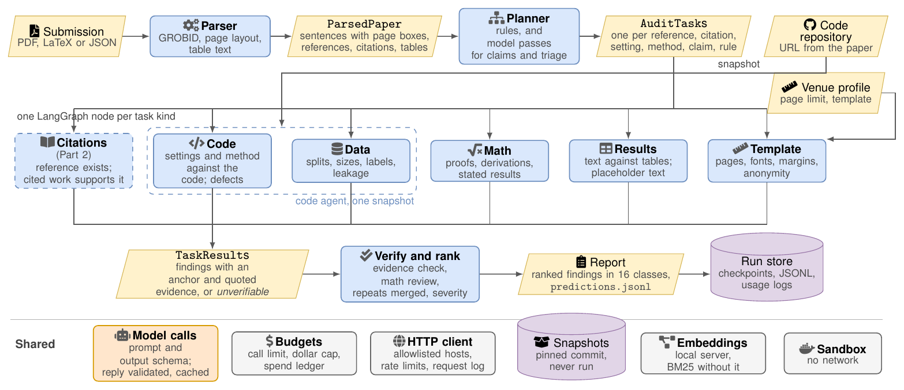

Code: <https://github.com/itikelabhaskar/Research_Paper_auditor> (branch `main`). Detailed
results per part: [p2-mid-results.md](p2-mid-results.md) (citations),
[p3-mid-results.md](p3-mid-results.md) (code, data, maths, results) with worked examples in
[p3_example_audit_report.md](p3_example_audit_report.md),
[parser_evaluation.md](parser_evaluation.md) (parser). Design decisions D1 to D22 are in
[decisions.md](decisions.md).

# 1. Progress

The auditor reads a submission, plans checkable items, sends each to a specialist and
reports findings with quoted evidence. RQ1 asks whether this agent system detects more
errors, with no more false alarms, than the same model in a single pass. Parsing, planning,
orchestration, the citation checker, the code and data agent, the template checker, the
theory checker and the integrity checks all run end to end on real papers. The verifier,
the report and the evaluation runner (Part 4) have not been built: a placeholder verifier
passes every finding to human review, and runs are scored before the verifier.

{width=90%}

| Part | Owner | Done | Open |
|---|---|---|---|
| 1. Parser, planner, orchestration, infrastructure, baselines | Bhaskar | GROBID + pdfplumber parser with a fallback citation linker and a LaTeX-source parser; planner; LangGraph orchestration with retries, resume and per-task budgets; B0 and B1 baselines; batch runner; Docker image | live run of the planner's LLM refinement (P1.12); failure analysis (P1.17) |
| 2. Citation checker | Anurag | Reference existence and metadata against arXiv, OpenAlex, Crossref and Semantic Scholar; claim support against retrieved full text; set A scored, set B built | second review of set B; multi-paper full-system set B run; BM25 against embeddings |
| 3. Code, data, template, theory, integrity | Vijay | Settings and metrics against the repository; data analysis mode; method check; claim loop; code defects; template checker; theory checker; integrity and results checks; sets C and D built; SPOT scored | second review of set C; adjudicating unlabelled flags; full-system runs against B0 and B1 |
| 4. Verifier, report, evaluation | Sudheera | not started in the repository | verifier, audit report, evaluation runner, verifier ablation |

In numbers: 64 merged pull requests, about 26,000 lines of source and 16,000 lines of tests,
1,229 tests passing, CI on Linux, macOS and Windows.

# 2. Datasets

| Set | What it tests | Size | State |
|---|---|---|---|
| A: HALLMARK | Reference existence and metadata | 831 entries (test-public split) | external, scored |
| B: claim-source pairs | Whether a cited source supports the claim | 60 arXiv papers, 158 gold labels (112 injected, 46 clean controls) | built and validated; second review pending |
| C: paper-code pairs (SciCoQA) | Settings, metrics and method against the official code | 40 pairs, 80 paper versions, 235 gold labels (63 setting errors, 72 clean-control labels, 92 method discrepancies) | built and validated; second review pending |
| D: planted integrity errors | Placeholder text, impossible means, prose claims a table contradicts, code defects | the 40 set C papers, 195 plants | built |
| SPOT | Errors in proofs and derivations | 26 papers, 29 annotated errors, dev and test halves of 13 papers | external, LLM judge |
| Parser fixtures | Citation linking, metadata | 10 arXiv papers, 100 hand-checked citation markers | hand-checked |
| Real cases | Errors authors later corrected | 33 arXiv withdrawals and revisions, 30 ICLR review cases | automatic labels |

Sets B and C are smaller than the proposal's targets (about 600 pairs and 160 instances).
Both were built from real papers with planted errors and clean controls, and each label was
checked against the source automatically before the set was accepted (D18).

# 3. Baseline experiments

B0 is the same model in a single pass with no tools. B1 is the same model as one agent with
every tool, in one pass, with no verifier (D14). Both are implemented
(`src/auditor/baselines/`) and share the full system's input and output format.

| Run | Set | Result | Cost |
|---|---|---|---|
| B0, Gemini 3.8 Flash, high thinking | SPOT, all 26 papers | 4 of 29 errors, in 3 papers, from 33 reports | $3.39 |
| Full system (theory checker), scored by the same judge | SPOT test half | 5 of 14 errors, in 4 of 13 papers, from 12 reports | $1.68 |
| B0 on the same test half | SPOT test half | 4 of 14 errors, in 3 papers | (part of the run above) |
| B1, Gemini 2.5 Flash | Set B, 15 papers (pre-correction labels) | macro-F1 0.026; 0 of 14 clean controls flagged | |
| B1 smoke run | 3 papers | 25 model calls, 30 tool calls, no loops | |

On the SPOT test half the full system finds one more error than B0 at the same cost per paper
(about $0.13), and 9 of its 12 reports match an annotated error. The set B run of B1 used labels that have since been corrected
and an older agent. The RQ1 comparison on sets B, C and D (full system against B0 and B1,
with false alarms on the clean originals) has not been run yet; it is the main work before
the final submission.

# 4. Results

| Check | Set | Result |
|---|---|---|
| Citation linking (parser) | 10 papers, 797 markers | 96.0% linked; precision 1.00, recall 0.99 on 100 checked markers |
| Reference existence and metadata | Set A, 831 entries | accuracy 0.851; flagging precision 0.902, recall 0.857, F1 0.879; 16% false alarms on valid entries |
| Training settings in code | Set C, 60 planted | 60 of 60, precision 1.00; 0 of 72 clean controls flagged |
| Evaluation metric in code | Set C, 3 planted | 2 of 3 |
| Method against code | Set C, 57 synthetic discrepancies | 17 of 57 (Gemini 3.8 Flash, about $1) |
| Proof and derivation errors | SPOT test half | 8 of 14 by the first judge, 5 of 14 when both judges agree |
| Placeholder text, GRIM-impossible means | Set D | 40 of 40 each |
| Reversed comparison, wrong gain between table rows | Set D | 28 of 33, 21 of 33 |
| Changed number quoted from a table | Set D2 | 2 of 10, no false alarm on 254 clean papers |
| Code defects (undefined names, syntax errors) | Set D | 26 of 26, 13 of 13 |
| Template rules | 15 fixtures | 15 of 15 |

On real papers the system found a reversed comparison in arXiv 2312.11580 ("PlaNet-S (0.73)
is higher than U-Net (0.78)"), a mean score of 8.93 in 2512.21706 that its own Table 6 gives
as 6.30, and a paper that says it uses no data shuffling while every training loader in its
code shuffles (2006.06958).

# 5. Ablations

| Question | Variants compared | Result |
|---|---|---|
| Table reading | GROBID; layout text; both; text inside table crops; crop image read by a model | 57%, 43%, 72%, 96 to 98%, 96% of table numbers recalled (12-paper LaTeX benchmark) |
| Code retrieval for the method check | word overlap; BM25 over function chunks; nomic embeddings; BM25 + embeddings; reranker | changed line shown 35, 48, 59, 57, 57 of 84 |
| How the model reads the code | whole files; sentence-code pairs; retrieved chunks ("rag"); tool-using claim loop | 2, 0, 4, 1 of 28 on 10 pairs |
| Reading model | Gemini 3.8 Flash; 3.1 Pro; DeepSeek V4.1 Flash; Kimi K2; GLM-5; Flash-Lite | 17, 19, 19, 13, 11, 7 of 57 |
| More code in the prompt | 60k against 120k characters | 17 against 16 of 57 |
| Theory pipeline | cheap screen then deep check; one call; triage; pooled triage; two looks | 2 of 29; 4 of 29; 8 of 14; 7 of 14; 6 of 14 (both judges) |
| Claim-loop effort | medium; low with a per-claim time limit | 32 against 0 task timeouts on 3 papers; $0.63 against $0.47 |
| Citation fixes (set A) | before and after the author, year and venue fixes | false alarms on valid entries 31% to 16%; F1 0.798 to 0.879 |
| Retrieval scope (set B, B1) | full text against abstract only | macro-F1 0.026 both; too few claim labels to separate them |

Planned in the proposal but not yet measured: removing the verifier (needs Part 4), the
model-only run against the tool-using system on sets B and C (RQ1), and Recall@5 of gold
evidence passages on a set with enough passages (7 records so far).

# 6. Challenges and mitigation

| Challenge | Effect | Mitigation |
|---|---|---|
| Verifier, report and evaluation runner not started | the "remove the verifier" ablation and the grounding metric cannot be measured; every finding goes to human review | the team assigns the verifier on 31 October; a first version re-checks each finding's quote against its source, which the specialists already require |
| No RQ1 comparison yet | the +10 pp macro-F1 hypothesis is untested | run full system, B0 and B1 on sets B, C and D (B0 once, B1 and full system three times, per the proposal) in the first week of November |
| Second review of sets B and C pending (D18) | sets are not frozen | each part owner reviews the other's 20% sample by 2 November |
| Models miss what they are shown | 26 of the 57 method misses were in code the model saw | ask about one method sentence at a time with its own code; repeat looks, which already help on SPOT |
| Judges disagree on SPOT | 8 against 5 matched errors on the test half | report both counts; add a third judge for the disagreements |
| Unlabelled flags | 152 set C flags match no label | adjudicate a sample; real mismatches already found among them |
| Slow and rate-limited services | citation lookups make full runs network-bound; GitHub allows 60 unauthenticated requests an hour; Vertex latency varied from 19 s to 86 s per call | HTTP and snapshot caches; GitHub token; per-task and per-claim time limits |
| Shared cloud credits | each paid run is capped | a spend ledger and a per-run dollar cap (`AUDITOR_LLM_MAX_COST_USD`) |
| Small claim classes in set B | 4 number and 3 support labels | grow them from more papers before the final runs |

# 7. Timeline to the final submission (14 November)

| Dates | Work | Owner |
|---|---|---|
| 31 Oct to 2 Nov | Second reviews of sets B and C, freeze the sets; agree the verifier design | all |
| 31 Oct to 4 Nov | First verifier version and audit report; evaluation runner over all sets | Part 4, with Part 1 |
| 3 to 6 Nov | RQ1 runs: full system, B0 and B1 on sets B, C and D, with false alarms on the clean originals | Parts 1 to 3 |
| 5 to 8 Nov | Ablations: verifier removed, model-only, abstract-only retrieval, single agent | Parts 2 to 4 |
| 7 to 10 Nov | Failure analysis; adjudicate unlabelled flags; method-check and table-number fixes | Parts 1 and 3 |
| 10 to 13 Nov | Write-up, figures, demo on real papers | all |
| 14 Nov | Final submission, tagged release of the repository | all |
